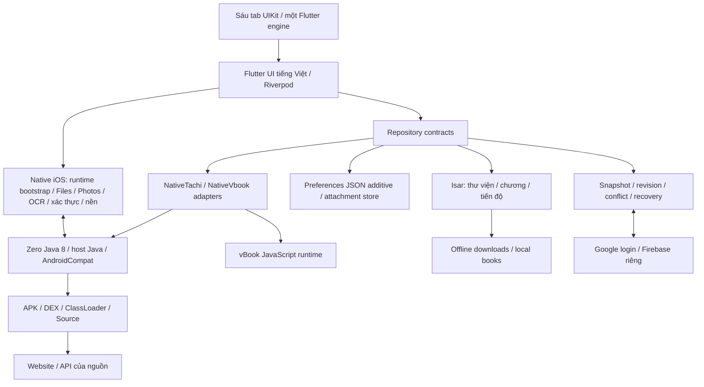

# Kế hoạch tiếp tục TachiBooks theo Tachimanga 5.0

Đây là kế hoạch kỹ thuật và tiêu chí nghiệm thu, không phải báo cáo tính năng đã triển khai. `PROJECT_STATE.md` vẫn là nơi duy nhất ghi trạng thái thực tế của dự án. Ngày lập: 17/10/2026, múi giờ Việt Nam.

## 1. Kết quả cần đạt và phạm vi

Tiếp tục bản TachiBooks đã có sửa đổi và tính năng tại `keo1512/Tachi-custom`, dùng source hiện tại làm nền. Đối chiếu chức năng, giao diện và thao tác với Tachimanga 5.0 build 511 theo ba tài liệu người dùng cung cấp, đồng thời bảo toàn những phần người dùng đã bổ sung. Giữ 18 nhóm; loại nhóm 12 về tracker/theo dõi dịch vụ ngoài và các phần liên quan trong nhóm khác. Giữ số thứ tự nhóm gốc để truy vết tài liệu.

Môi trường người dùng đã xác nhận: Windows và iPhone 15 Pro Max/iOS 27.0.1; build iOS qua GitHub Actions tại `keo1512/Tachi-custom`; người dùng tự cài, thử và góp ý. Repo đã public và được tiếp nhận tại commit `5906375e0039f99fe67f1d7232376c43dfe95cea`. Pipeline/manual dispatch đã có; lượt này chưa chạy workflow hoặc tạo IPA mới. Yêu cầu chưa đóng gói IPA vẫn có hiệu lực.

Các điều chỉnh sản phẩm cần áp dụng từ đặc tả:

- Tên TachiBooks; giao diện do ứng dụng kiểm soát chỉ dùng `vi-VN`, không có bộ chọn ngôn ngữ. Nội dung truyện, nguồn, tên tác giả và OCR giữ nguyên ngôn ngữ nội dung.
- Giữ sáu tab UIKit hiện tại: Thư viện, Cập nhật, Duyệt, Tải xuống, Lịch sử, Thêm; giữ Flutter engine chung, cấu hình tab và trạng thái điều hướng.
- Không quảng cáo, thanh toán, Premium, khóa tính năng, hoặc màn hình phân phối App Store/TestFlight. Các chức năng được xây dựng như chức năng thường của TachiBooks.
- Tham chiếu giao diện bản 5.0; không tự thêm Reader Toolbar Liquid Glass của bản 5.1.
- Phân phối mục tiêu qua SideStore bằng tài khoản miễn phí. Phần ký không thực hiện trong phạm vi hiện tại; pipeline dự kiến xuất IPA chưa ký cho quy trình cài của người dùng.
- Giữ Google login/Firebase và cơ chế đồng bộ riêng hiện có, bao gồm nội dung offline trong snapshot, kiểm tra revision, recovery và giải quyết xung đột. iCloud Drive qua Files vẫn nằm trong phạm vi nhập/xuất.
- Không triển khai kết nối tracker/theo dõi qua MyAnimeList, AniList, Bangumi, MangaUpdates, MangaBaka, Komga, Kavita hoặc Suwayomi. Bỏ lối vào và thống kê dịch vụ ngoài. Giữ trạng thái/đánh giá cục bộ; giữ nguyên dữ liệu tracker opaque đã nhập trong backup/sync để tương thích và tránh mất dữ liệu, không đăng nhập hoặc gọi dịch vụ từ dữ liệu đó. Komga/Kavita/Suwayomi làm nguồn nội dung không thuộc phần theo dõi đã loại.
- Tiến độ đọc cục bộ, đánh dấu đã đọc/chưa đọc, lịch sử, bookmark, tiến độ tải và đồng bộ riêng TachiBooks vẫn nằm trong phạm vi.
- Giữ truyện chữ, EPUB/TXT, đọc thành tiếng, extension vBook, folder/danh mục, thống kê thời lượng và các tính năng đã bổ sung. Đối chiếu IPA áp dụng cho phần có tương đương; phần bổ sung được nghiệm thu theo hợp đồng hiện có và yêu cầu người dùng.
- Giữ các khả năng có điều kiện của đặc tả: codec, OCR/dịch, tải nền, icon thay thế và phần cứng iPad/Pencil chỉ được công bố hoạt động sau khi có kiểm chứng tương ứng.

"Giống hệt" được nghiệm thu theo ba trục: hình thức, thao tác và kết quả dữ liệu. Những điều chỉnh ở trên là khác biệt có chủ đích. Wireframe được đánh dấu [Đề xuất] chưa phải bằng chứng về bố cục gốc; các phần này phải đối chiếu app thật hoặc được người dùng chọn làm chuẩn trước khi khóa thiết kế.

### Quy tắc bắt buộc: đối chiếu từng phần với IPA Tachimanga

Áp dụng ở mọi mốc M0–M8, trước khi triển khai, sau mỗi thay đổi và trước khi đánh dấu hoàn thành từng phần; không dồn việc đối chiếu vào M8.

1. Xác định phần cần làm theo ID yêu cầu/màn hình/luồng và tìm bằng chứng tương ứng trong IPA Tachimanga gốc 5.0 build 511. Bản repack TachiBooks không được dùng thay IPA gốc làm chuẩn.
2. Với tài nguyên, contract và dữ liệu: đối chiếu metadata, assets, bytecode/source đã xác minh tương ứng với IPA, request/response và kết quả dữ liệu. Source fork và tài liệu phân tích chỉ hỗ trợ; chưa chứng minh khớp IPA thì không thay thế chuẩn.
3. Với UI/thao tác: đối chiếu app gốc và TachiBooks trên cùng tình huống, nội dung, theme, kích thước và cấu hình thiết bị; kiểm tra bố cục, font/màu/khoảng cách, menu, cử chỉ, điều hướng và các trạng thái phụ. Khi cần runtime, sử dụng kết quả thử/ảnh/video từ iPhone của người dùng; phân tích tĩnh không đủ xác nhận cảm giác thao tác.
4. Gắn kết quả với đúng commit/build TachiBooks đã kiểm tra, ghi bằng chứng tham chiếu, điểm khớp, sai khác còn lại và phạm vi chưa xác nhận. Bằng chứng đặt dưới `verification/`; trạng thái hoàn thành vẫn chỉ ghi ở `PROJECT_STATE.md`.
5. Sửa sai khác và đối chiếu lại phần thay đổi cùng các luồng có thể bị ảnh hưởng. Không đánh dấu hoàn thành hoặc "đã giống" khi còn sai khác chưa được chấp nhận hay thiếu bằng chứng cần thiết; có thể báo riêng phần triển khai/CI đã xong nhưng đối chiếu thiết bị chưa xác nhận.
6. Giữ các khác biệt người dùng đã yêu cầu: tên TachiBooks, UI tiếng Việt, sáu tab UIKit, truyện chữ/vBook, không quảng cáo/thu phí, loại kết nối tracker và dịch vụ đồng bộ riêng. Phần không có tương đương trong IPA được nghiệm thu theo yêu cầu tương ứng, không tự gọi là giống app gốc. Mọi khác biệt khác cần người dùng chấp thuận trước khi coi đạt.

Mẫu bằng chứng cho mỗi phần: `ID yêu cầu → thành phần/tình huống tham chiếu trong IPA gốc → build TachiBooks → cách kiểm tra → kết quả/ảnh/log → sai khác còn lại`. Các cột `parity_rule` và `parity_acceptance` trong bảng truy vết nhắc điều kiện này cho từng mục còn trong phạm vi, không ghi tiến độ riêng.

## 2. Tài liệu đầu vào và bằng chứng

| Tài liệu | Phạm vi đã đọc | Cách sử dụng |
|---|---|---|
| `C:/Users/Nosgnoh/Downloads/tinh nang phai co.md` | 1.099 dòng; 19 nhóm; 999 mục bắt đầu bằng dấu gạch đầu dòng | Danh sách yêu cầu, bao gồm điều kiện hỗ trợ. 999 mục không đồng nghĩa 999 tính năng độc lập vì có mục lặp và chi tiết con. |
| `C:/Users/Nosgnoh/Downloads/# PHÂN TÍCH CƠ CHẾ HOẠT ĐỘNG CỦA TACHIMA.md` | 948 dòng; 10 phần chính | Giả thuyết/hợp đồng kỹ thuật để đối chiếu source, bytecode và runtime; không mặc định mọi nhận định đã được xác nhận. |
| `C:/Users/Nosgnoh/Downloads/TACHIMANGA_UI_UX_SPEC_DIAGRAMS_ONLY.md` | 2.102 dòng; 98 tiểu mục `###` | Danh mục màn hình, wireframe, trạng thái và luồng thao tác. |

Đã đọc toàn bộ 4.149 dòng của ba tài liệu, bao gồm Mermaid và các đoạn CSS xuất kèm. Tài liệu UI nhắc tới 22 PNG trong một ZIP riêng; ba file hiện có không chứa các PNG đó. Kế hoạch không giả định đã xem các ảnh chưa được cung cấp.

Bảng `requirements_traceability.csv` cùng thư mục ánh xạ từng mục của danh sách tính năng, các tiểu mục UI, phần trạng thái/quy tắc UI chung và 10 phần cơ chế sang mốc thực hiện và loại bằng chứng cần có. Các cột `scope`/`scope_note` ghi phạm vi yêu cầu hiện hành, không phải trạng thái hoàn thành. Giữ nguyên trích dẫn tài liệu gốc và đánh dấu các mục tracker `excluded_by_user`; không dùng chúng làm yêu cầu triển khai.

Bằng chứng đã có từ IPA gốc:

- Phiên bản 5.0 build 511, minimum iOS 15.0, bundle ID gốc `com.mangacrush.ios`.
- Có Flutter AOT ARM64, phần native iOS, thư mục Java runtime và backend đóng trong `MCHome.bundle/res.zip`.
- `res.zip` có 27.686 file `.class`, bao gồm Suwayomi/Tachidesk, Android compatibility, thư viện bên thứ ba và thành phần `app/tachimanga`.
- Có logic extension, ảnh, tải xuống, SQLite/migration và controller API. Đã thấy tham chiếu `NativeChannel`, `JNI_CreateJavaVM`, hàng chờ, tải song song và CBZ.
- Bản đóng gói lại đã tạo trước đây chỉ thay metadata/localization. Nó không đáp ứng mục tiêu mã nguồn mới và không phải đầu vào của pipeline TachiBooks mới.

Phát hiện nguồn công khai phục vụ kế hoạch:

- [tachimanga/Tachidesk-Server](https://github.com/tachimanga/Tachidesk-Server) có mã Java/Kotlin, AndroidCompat và lớp native bridge phía Java. HEAD đã kiểm tra: `2e52214106ffab02d13ff61a620def78414a8a45`; 751 file trong cây, gồm 358 `.java`, 313 `.kt`.
- [NativeChannel.java](https://github.com/tachimanga/Tachidesk-Server/blob/2e52214106ffab02d13ff61a620def78414a8a45/AndroidCompat/src/main/java/org/tachiyomi/NativeChannel.java) khai báo `native call_utf8`; Java source không cung cấp thay cho phần triển khai native đó.
- [server/build.gradle.kts](https://github.com/tachimanga/Tachidesk-Server/blob/2e52214106ffab02d13ff61a620def78414a8a45/server/build.gradle.kts) phụ thuộc `sqlite-jdbc-ios-3.41.0.0.jar` và `cloud-api-1.0.0.jar`; cả hai hiện có dưới dạng JAR trong repo. Sự hiện diện của JAR chưa chứng minh có source/build recipe đầy đủ cho chúng.
- Source `PackageTools.kt` trong fork có Dex2jar và giới hạn thư viện extension 1.3–1.6. Đây là dữ liệu đối chiếu hữu ích, chưa chứng minh toàn bộ fork khớp bytecode của IPA 5.0.
- Repo `tachimanga/tachimanga` chỉ có README trong cây hiện tại; `tachimanga.github.io` là website. Chưa có mã nguồn đầy đủ phần ứng dụng Flutter và runtime iOS được xác nhận.

Ưu tiên source công khai đúng phiên bản; chỉ dịch ngược phần chênh lệch hoặc phần thiếu. Không lấy nhánh mới nhất của Suwayomi thay thế toàn bộ rồi mặc định tương thích.

## 3. Các quyết định cần kiểm chứng trước khi triển khai diện rộng

| Vấn đề | Hướng của kế hoạch | Bằng chứng cần có trước khi chốt |
|---|---|---|
| Runtime Java trên iOS | Rà soát runtime Zero Java 8 đã tích hợp trong `packages/tachi_runtime`; không thay VM chỉ vì IPA gốc dùng OpenJ9 | Đúng artifact CI chạy trên iPhone; nạp class động, HTTPS, callback JNI và khôi phục sau mở lại hoạt động |
| Nguồn runtime gốc | Tìm build recipe/nguồn tương ứng, đối chiếu ABI và thư viện native | Inventory phụ thuộc có xuất xứ và build recipe; không dùng mỗi thư mục `jre/` làm bằng chứng runtime hoàn chỉnh |
| Backend source | Giữ host Java hiện có trong `tools/native_extension_engine`; fork Tachimanga tại `engine/` chỉ làm tư liệu đối chiếu, không thay engine sản phẩm | Kiểm thử host hiện có và so sánh contract/hành vi với class tương ứng trong IPA; không đồng nhất hai engine |
| Giao diện gốc | Dùng app 5.0 build 511 làm chuẩn cho phần chưa bị đặc tả điều chỉnh | Màn hình/video thao tác có ngữ cảnh, cùng phiên bản, kích thước, theme và trạng thái |
| iOS tối thiểu | Mốc tham chiếu ban đầu là iOS 15 theo IPA; không tự nâng deployment target vì một tính năng mới | Phiên bản iOS trên iPhone của người dùng; hỗ trợ Flutter/plugin/runtime đã được thử |
| iPad/Pencil và nhiều thiết bị | Giữ đầy đủ trong phạm vi, triển khai khả năng thích ứng | Cần thiết bị tương ứng để nghiệm thu; iPhone đơn lẻ không chứng minh các phần này |
| Định danh ứng dụng | Giữ bundle ID `dev.tachibooks.tachiBooks` và URL scheme hiện có | Kiểm tra nâng cấp giữ sandbox, mở link và callback đăng nhập; không đổi định danh tùy tiện |
| Mức tương thích backup | Nhập Tachimanga/Tachiyomi/Mihon qua adapter, không dùng mở rộng file để đoán định dạng | Các backup fixture thực tế, codec và mapping đã thử |

IPA gốc có dấu vết OpenJ9/JDK 17 và `-Xint`; app hiện có dùng prebuilt Zero Java 8 từ Pojav với checksum/provenance riêng. Hai runtime khác nhau. `sourceCorrespondenceVerified=false` và `deviceRuntimeVerified=false` trong manifest hiện tại vẫn là giới hạn phải kiểm chứng; compile host hoặc XCTest simulator không chứng minh JVM chạy trên iPhone. Nghiên cứu OpenJDK Mobile không phải quyết định thay runtime sản phẩm.

Nếu chưa vượt được mốc runtime iOS, dừng mở rộng phần phụ thuộc engine để xử lý nguyên nhân. Có thể làm UI và kiểm thử hợp đồng độc lập trong lúc đó, nhưng không gọi một client kết nối Windows/server ngoài là sản phẩm offline độc lập tương đương yêu cầu. Mọi hướng đổi sang engine từ xa hoặc giảm tương thích extension đều là thay đổi phạm vi cần người dùng quyết định.

## 4. Kiến trúc hiện có cần bảo toàn



- Flutter: Clean Architecture, feature-first, Repository Pattern, MVVM, Riverpod, go_router. iOS là nền tảng sản phẩm được yêu cầu; không tự mở rộng Android trong kế hoạch này.
- Host Java hiện có: chạy extension gốc và AndroidCompat; adapter Dart giữ giao thức hiện tại. vBook giữ runtime riêng. Không thay host bằng toàn bộ fork JVM 17 hoặc mở server bắt buộc.
- Swift/Objective-C++/C/C++ khi cần: plugin iOS khởi tạo runtime, JNI/native callbacks và API hệ thống. Không chạy công việc nặng trên main thread.
- Một owner cho mỗi dữ liệu. Giữ Isar/schema/repository thư viện hiện tại, attachment store và preferences JSON additive; không chuyển dữ liệu sang SQLite của fork tham chiếu.
- Giữ cơ chế transaction/revision và recovery hiện có. Thay schema/storage/API cần migration và chứng cứ tương thích, không phát sinh bản sao domain hoặc outbox thay thế ngoài phạm vi.
- Luồng nghiệp vụ offline-first: UI → Repository → Local → Sync. Native engine chạy trên thiết bị; companion tùy chọn không trở thành yêu cầu bắt buộc.
- Tầng mạng phân biệt nguồn truyện, loopback engine và sync độc lập. Chuyển nguyên request method/headers/cookie cần thiết; thông tin đăng nhập lưu Keychain, không ghi token vào log.
- Nếu dùng HTTP nội bộ: bind loopback, không hard-code cổng 4567 như kết luận runtime; có handshake/version, giới hạn thời gian chờ, định danh phiên và vòng đời khởi tạo/dừng. API và callback native phải được đo, không suy ra chỉ từ strings.

Cấu trúc nguồn hiện có trong chính dự án `D:/Codex/TachiBooks`:

```text
lib/, ios/, test/                 App Flutter và sáu tab UIKit hiện có
packages/tachi_runtime/           Plugin JNI / runtime Zero / native iOS
packages/vbook_runtime/, runtime/ Plugin và runtime JavaScript vBook
tools/native_extension_engine/    Source host Java / AndroidCompat / build helpers
tools/, scripts/                  Build, đối chiếu và kiểm chứng artifact
engine/                           Snapshot fork Tachimanga: chỉ tham chiếu, gitignored
docs/                             Đặc tả và kế hoạch; không ghi tiến độ thay PROJECT_STATE
verification/                     Bằng chứng kiểm tra theo commit/build
PROJECT_STATE.md                   Trạng thái hiện tại duy nhất
```

Chỉnh trực tiếp source này, không tạo skeleton hoặc bản sao ứng dụng. Giữ payload/IPA tham chiếu hiện có và không chỉnh IPA nguồn Downloads.

## 5. Lộ trình và điều kiện qua mốc

### M0 — Khóa đặc tả và chuẩn đối chiếu

Công việc:

- Chốt phạm vi 18 nhóm còn lại qua bảng truy vết và các khác biệt có chủ đích ở mục 1; nhóm 12 và mọi phần tracker liên quan bị loại.
- Ghi hash IPA và các tài liệu, inventory tài nguyên/bytecode/framework/runtime/native dependency.
- Xác định phiên bản iOS, model iPhone, app Tachimanga đang có và khả năng đối chiếu build 511.
- Chọn bộ truyện/nguồn thử ổn định, một bộ truyện local tự kiểm soát, backup hợp lệ/hỏng và các trường hợp chapter đặc biệt.
- Đo UI gốc: font, màu, spacing, tỷ lệ bìa, thanh tab, sheet, toolbar, animation, vùng chạm, cử chỉ, trạng thái khi quay lại.
- Phân loại từng chi tiết: yêu cầu sản phẩm, đã thấy trong source/IPA, đã quan sát trên thiết bị, hoặc đề xuất chưa chốt.

Đầu ra: baseline có thể so sánh, danh sách dữ liệu thử và mapping source/feature/UI. Phần thiếu hình tham chiếu vẫn được ghi rõ, không ngăn phân tích engine hoặc chuẩn bị CI.

Qua mốc khi: không còn nhầm lẫn giữa tính năng bắt buộc, bố cục đề xuất và tính năng đã được chứng minh; phạm vi khác biệt với Tachimanga được ghi nhận.

### M1 — Kiểm chứng engine và runtime iOS hiện có

Công việc theo thứ tự:

1. Đối chiếu fork công khai đã pin với các class engine trong IPA; chọn Extension, PackageTools, Source/Manga/Page, DownloadManager, DBManager, migration và NativeChannel làm tập đại diện.
2. Chạy baseline analyze/unit/widget/Isar và helper tests của app hiện có. Build fork tham chiếu chỉ phục vụ đối chiếu, không chứng minh host sản phẩm.
3. Kiểm chứng provenance/checksum/layout của Zero Java 8, dependencies và host Java từ source; chỉ rõ phần prebuilt chưa đối chiếu nguồn. Không dùng dịch vụ hoặc executable gốc Tachimanga.
4. Dùng workflow macOS và diagnostics hiện có khi được yêu cầu build: release không ký, native smoke, khởi tạo JVM và callback JNI trên thiết bị. Không tạo app thử thay thế làm mất tính năng hiện tại.
5. Thử nạp thêm một JAR thử sau khi app đã build, phản xạ/class loader, HTTPS/certificates, thread, filesystem trong sandbox và đóng/mở lại app.
6. Người dùng thử IPA trên iPhone bằng quy trình cài thực tế; không lấy Flutter debug có yêu cầu JIT làm bản nghiệm thu.

Đầu ra: source/build recipe tối thiểu và IPA thử runtime có build ID. App thử có phần chẩn đoán tiếng Việt có thể chia sẻ log đã loại thông tin nhạy cảm.

Qua mốc khi: bản CI trên iPhone khởi động engine, nạp class bổ sung, truy cập SQLite/mạng và callback native thành công trong chế độ được chọn. Nếu còn dùng native binary chỉ trích từ IPA, mốc "mã nguồn build lại đầy đủ" chưa qua.

### M2 — Chuỗi nguồn truyện đến đọc offline

Công việc:

- Thêm repository, kiểm tra index được hỗ trợ và nhập APK/JAR; xác minh metadata/phiên bản, chuyển DEX, chọn class loader, đăng ký Source/SourceFactory.
- Thử nhiều kiểu extension: HTML/JSON, nhiều nguồn, bộ lọc, nguồn có preferences/cookie; lập phạm vi tương thích theo đúng phiên bản gói.
- Duyệt phổ biến/mới nhất, phân trang, tìm kiếm, bộ lọc động và lỗi từng nguồn.
- Lấy bìa theo request đầy đủ; hỗ trợ trực tiếp/proxy theo contract đã kiểm chứng, tách cache và bìa tùy chỉnh.
- Lấy chi tiết, chương, Page và imageUrl gián tiếp; giữ thứ tự Page ban đầu dù tải song song.
- Hàng chờ download bền vững, sự kiện tiến độ có reconnect/resync snapshot, retry, pause/resume/cancel, lưu `.part` và hoàn tất nguyên tử.
- Đọc lại chương tải đủ sau khi bật chế độ máy bay và đóng/mở app. Khi offline file còn hợp lệ, không bắt buộc gọi website hoặc extension.

Đầu ra: một luồng thật từ repository/APK tới ảnh và offline, API contract có request/response/error/event mẫu đã loại bí mật.

Qua mốc khi: cài → nhận Source → duyệt → mở chi tiết → mở chương → tải đủ → đóng app → chế độ máy bay → đọc lại thành công trên iPhone. Một extension pass chưa đủ để công bố tương thích mọi extension.

### M3 — Sáu tab UIKit và quản lý dữ liệu hằng ngày

- Rà soát bộ thành phần giao diện hiện có theo baseline và 98 tiểu mục UI; giữ sáu tab UIKit được người dùng chọn và toàn bộ nhãn app bằng tiếng Việt.
- Hoàn thiện Thư viện, Danh mục, Khám phá, Chi tiết, Cập nhật, Lịch sử và trang Thêm/Cài đặt nền tảng.
- Lưới/danh sách, badge, bộ lọc ba trạng thái, preset, sort riêng danh mục, đa lựa chọn và thao tác hàng loạt.
- Notes, bìa tùy chỉnh, ưu tiên nhóm dịch, nhận biết chương trùng và giữ ID/tiến độ qua refresh.
- Cập nhật thủ công/điều kiện, summary thành công/lỗi/bỏ qua; UI hàng chờ và danh sách offline.
- Giữ tab, vị trí cuộn, bộ lọc, thứ tự chương và ngữ cảnh khi vào/ra Reader; xử lý empty/loading/error/permission/partial failure.
- Đặt nền tảng privacy và credential storage ngay khi thêm dữ liệu nhạy cảm; không để đến cuối mới sửa kiến trúc.

Qua mốc khi: dùng dữ liệu thật thực hiện được các luồng chính từ sáu tab; đóng/mở app vẫn giữ dữ liệu; lỗi một nguồn không làm mất kết quả các nguồn còn lại.

### M4 — Trình đọc đầy đủ và cảm giác thao tác

- LTR, RTL, lật dọc, Webtoon, hai trang, nhận diện trang ngang; đảo ghép, bỏ trang đầu, hướng xoay và thiết lập riêng từng truyện.
- Zoom/pan/double-tap/kính lúp, fit/crop/margins, màu nền; giữ vị trí đọc khi đổi mode, xoay hoặc đổi kích thước.
- Vùng chạm, toolbar/slider/nhảy trang, chuyển chương, preload có giới hạn, ưu tiên trang đang đọc, retry riêng một trang.
- Auto scroll, auto page theo thời gian, nhấn giữ cuộn và đổi tốc độ; xử lý xung đột với nhấn giữ mở menu, pan/zoom và vuốt quay lại theo mode/cài đặt.
- Menu ảnh: lưu/sao chép/chia sẻ/đặt làm bìa; cầu nối OCR, chọn chữ và dịch theo khả năng iOS. Phân biệt hệ tọa độ ảnh với ảnh đang zoom/crop.
- Lưu tiến độ theo chapter/page/offset; chỉ đánh dấu hoàn tất khi đủ điều kiện, không chỉ vì ảnh cuối đã được preload.
- Tính thời gian đọc theo phiên hoạt động; dừng khi app không hoạt động hoặc không thực sự đọc.
- Bàn phím/chuột và hook Pencil dùng chung command Reader; nghiệm thu Pencil/iPad khi có thiết bị tương ứng.

Qua mốc khi: toàn bộ nhóm 6 có đường kiểm thử và bằng chứng phù hợp; cử chỉ không giành nhau, vị trí khôi phục chính xác, chương dài không giữ toàn bộ ảnh full-resolution trong RAM.

### M5 — Dữ liệu local, chuyển nguồn, backup và thống kê

- Local Source: Files, file/thư mục, thứ tự tự nhiên, `cover.jpg`, `details.json`, quét lại, truyện thiếu file và mất quyền truy cập.
- Codec/archive: từng định dạng bắt buộc đi kèm fixture; bảo toàn reader chữ EPUB/TXT, TTS và vBook đã có, cùng reader manga cuộn dọc.
- RAR/CBR/HEIF/AVIF/JPEG XL có ma trận hỗ trợ thực tế theo thư viện/OS; trường hợp không hỗ trợ có thông báo tiếng Việt và không làm hỏng bộ dữ liệu nhập.
- Chuyển nguồn đơn/hàng loạt: preview ghép, chỉnh tay, giữ dữ liệu gốc, chapter thập phân/không số/trùng nhóm dịch; commit từng đơn vị an toàn, có thể hủy giữa các đơn vị.
- Backup native có version/schema, checksum và adapter Tachimanga/Tachiyomi/Mihon. Phân biệt metadata với file offline; không ngầm tuyên bố backup chứa ảnh tải nếu không có.
- Restore: validate → preview gắn revision → tạo recovery snapshot → transaction/atomic replace → kiểm tra → rollback khi lỗi. Không ghi đè file backup đầu vào.
- Thống kê lấy từ dữ liệu thật, kiểm soát trùng phiên và ảnh hưởng ẩn danh; không dựng biểu đồ chỉ có dữ liệu giả rồi coi là xong.

Qua mốc khi: round-trip backup trên dữ liệu đại diện giữ thư viện, danh mục, tiến độ, bookmark, lịch sử và notes trong phạm vi codec; file hỏng/mất nguồn/restore bị gián đoạn không làm mất dữ liệu đang dùng; chuyển nguồn không làm sai tiến độ.

### M6 — Tích hợp iOS, bảo mật và công cụ nâng cao

- Bỏ UI kết nối/thống kê dịch vụ tracker. Giữ trạng thái/đánh giá trên máy và dữ liệu tương thích trong backup; không xóa dependency dùng chung mà nguồn truyện vẫn cần.
- WebView, cookie bridge theo domain/path/expiry, User-Agent, xóa dữ liệu và đăng nhập nguồn; thử challenge bằng tương tác người dùng khi nguồn cho phép, không hứa mọi nguồn Cloudflare đều qua.
- Files/Photos/Share Sheet, Face ID/Touch ID hoặc phương thức thiết bị, Keychain, app lock, mã riêng nếu chọn, rate limiting, App Switcher cover, URL scheme, thông báo cục bộ.
- Cài đặt đầy đủ, theme/icon/tab, cache/storage diagnostics, phát hiện và khôi phục database; log có thể xuất từ iPhone với build ID.
- Tải/cập nhật nền: có capability theo OS, cancellation/expiration, checkpoint và báo trạng thái đúng. Thử riêng chuyển app, khóa màn hình, mất mạng, app bị hệ thống dừng và force quit.
- iPad/Pencil/mouse/keyboard được triển khai theo cùng command/state; giữ mục nghiệm thu thiết bị riêng nếu người dùng chỉ có iPhone.

Qua mốc khi: tích hợp native đã thử đúng thiết bị/OS, quyền bị từ chối có lối xử lý, không còn UI/tác vụ tracker và không có chức năng chỉ hiển thị công tắc nhưng chưa hoạt động.

### M7 — Đồng bộ đa thiết bị bằng dịch vụ riêng

- Giữ abstraction, Google login và Firebase project riêng đã tích hợp. Kiểm tra đăng nhập/đăng xuất/session, không thêm luồng mật khẩu hoặc đổi backend ngoài yêu cầu.
- Giữ giao thức snapshot/chunks, giới hạn 128 MiB, media offline, revision và recovery hiện tại; không đổi sang outbox/delta sync như điều kiện bắt buộc của giai đoạn này.
- Kiểm tra ID, quyền sở hữu tài khoản, hủy/retry, sửa đồng thời và khôi phục nguyên tử theo hợp đồng hiện tại.
- Giữ thư viện/danh mục/tiến độ/bookmark/notes/cấu hình/nội dung offline và gói extension theo phạm vi codec hiện có. Metadata tracker đã nhập tiếp tục round-trip như dữ liệu tương thích, không tạo liên kết dịch vụ.
- Credential/cookie không được mặc định xuất sang backup/sync. Không tự tải hoặc chạy gói extension từ metadata chưa được xác minh.
- Merge theo loại dữ liệu: bảo toàn thao tác đánh dấu chưa đọc có chủ đích, không lấy `max(chapter)` cho mọi trường hợp; phân biệt tiến độ và history event; xử lý xóa, sửa đồng thời, thiết bị offline lâu ngày và đổi tài khoản.
- Có màn hình trạng thái và giải quyết xung đột; dữ liệu local dùng được khi dịch vụ lỗi; queue gửi lại không tạo bản ghi trùng.

Qua mốc khi: ít nhất hai client độc lập vượt các kịch bản offline/sửa đồng thời/xóa/đăng xuất/đăng nhập lại. Kiểm thử giả lập dịch vụ và một iPhone chưa đủ để gọi đã nghiệm thu đa thiết bị iOS.

### M8 — Đối chiếu độ giống, ổn định và bản nghiệm thu

- Duyệt đủ bảng truy vết, mỗi yêu cầu có bằng chứng tương ứng; không dùng số màn hình đã dựng thay cho mức hoàn thành.
- Đối chiếu hình trên cùng iPhone, cùng theme/nội dung/trạng thái: font, spacing, màu, bìa, toolbar, sheet, menu và vùng chạm.
- Đối chiếu thao tác và điều hướng: click path, long press, scroll, animation, selection, back state, reader resume.
- Chạy các tình huống hỏng/mất mạng/thiếu dung lượng/đổi extension/app bị dừng/upgrade/migration/restore/cancel; không để mất thư viện hoặc file gốc.
- Đo thời gian mở app/engine, trang đầu, chuyển trang, scroll frame timing, peak RAM với Webtoon dài và dung lượng download. Ngưỡng số được chốt từ iPhone và baseline thực tế, không đặt số tùy ý trước khi đo.
- Build cuối từ source trong CI sạch với dependency đã pin, kiểm tra artifact và version/hash; user cài đúng artifact đó để nghiệm thu lại phần bị ảnh hưởng.
- Ghi nhận rõ nhóm chưa thử do thiếu iPad, Touch ID, thiết bị thứ hai hoặc tài khoản dịch vụ. Có thể có bản dùng thử iPhone, nhưng không gọi đủ toàn bộ phạm vi khi các mục bắt buộc còn chưa được kiểm chứng.

## 6. Phủ 18 nhóm và loại nhóm tracker theo yêu cầu

| Nhóm trong danh sách bắt buộc | UI tham chiếu | Mốc triển khai chính | Nghiệm thu điển hình |
|---|---|---|---|
| 1. Thư viện | 3.x | M3 | Lọc/sort/selection/batch, giữ dữ liệu và vị trí qua restart |
| 2. Danh mục | 4.x | M3 | Nhiều danh mục cho một truyện, reorder; xóa danh mục giữ truyện |
| 3. Duyệt/tìm | 5.x | M2, M3 | Phân trang, dynamic filter, nhiều nguồn lỗi độc lập |
| 4. Extension/repo | 5.3–5.6 | M1, M2 | APK/JAR thực, SourceFactory, update/uninstall, lỗi tương thích |
| 5. Chi tiết/chương | 6.x | M2, M3 | Refresh không mất tiến độ, chapter thập phân/trùng, bìa riêng |
| 6. Reader | 7.x | M4, M6 | Đủ mode/cử chỉ, resume, OCR, ảnh lỗi/lớn và ngoại vi |
| 7. Download | 8.x, 16.7 | M2, M3, M6 | Hàng chờ bền vững, cancel/retry, offline sau restart, nền theo OS |
| 8. Cập nhật | 9.x, 16.5 | M3, M6 | Summary chính xác, skip reason, partial failure, thông báo |
| 9. Lịch sử | 10.x | M3, M7 | Resume đúng trang, xóa có phạm vi, ẩn danh và sync |
| 10. Chuyển nguồn | 11.x | M5 | Preview sửa được, giữ tiến độ, hủy an toàn, giữ truyện cũ |
| 11. Truyện local | 12.x | M5 | Fixtures từng codec/archive, quyền Files, quét/đọc offline |
| 12. Tracker — ngoài phạm vi | 13.x bị loại | Không triển khai | Không tạo kết nối/UI dịch vụ; dữ liệu đã nhập được bảo toàn cho tương thích |
| 13. Backup/restore | 14.x | M5 | Round-trip, recovery/rollback, fixture legacy, file lỗi |
| 14. Thống kê | 15.x | M5 | Số liệu tái lập được, không tính trùng hoặc thời gian inactive |
| 15. Giao diện | 1.x, 2.x, 16.x | M3, M6, M8 | Tiếng Việt, theme/tab/icon, đối chiếu giao diện thật |
| 16. Riêng tư | 17.x | M3, M6, M7 | Khóa/ẩn preview, credential, giới hạn phạm vi history/sync |
| 17. Nâng cao | 5.8, 16.8–16.10 | M5, M6 | Tách cache/download, diagnostics hữu ích, sửa DB có recovery |
| 18. Đồng bộ | 18.x | M7 | Hai client, offline, conflict, tombstone và không nhân bản dữ liệu |
| 19. iOS/iPad | 19.x, phần Reader | M1, M4, M6, M8 | Quyền, Files/Photos/OCR/background; nghiệm thu iPad/Pencil riêng |

## 7. Hợp đồng dữ liệu và invariant bắt buộc

- Source ID phải đi qua JSON/Firestore/Dart mà không mất chính xác số 64-bit; chuẩn giao tiếp dùng biểu diễn chuỗi khi cần. ID truyện gắn nguồn và định danh gốc; không dùng tiêu đề làm khóa duy nhất.
- Chapter ID ổn định khi refresh. Số chương có thể thập phân hoặc không xác định; không dùng số chương một mình để ghép tất cả bản của các nhóm dịch.
- Phân biệt metadata gốc, dữ liệu người dùng và dữ liệu tính toán. Refresh nguồn không ghi đè notes, bìa riêng, danh mục, bookmark hoặc tiến độ.
- `downloaded` chỉ true khi toàn bộ bộ trang cần thiết đã lưu và kiểm tra thành công. Đổi cờ DB đơn thuần không biến chương thành offline hợp lệ.
- Cache có thể dọn; bản download, local content và recovery backup có vòng đời riêng. Xóa cache không được xóa bản offline hoàn chỉnh.
- Request ảnh có URL, method, headers/cookie và thông tin nguồn cần thiết. Không persist hoặc log token có thời hạn như thể URL công khai vĩnh viễn.
- File đầu vào và backup người dùng không bị ghi đè. Nhập archive kiểm tra đường dẫn, kích thước khai báo/giải nén, file hỏng và dung lượng trước khi commit.
- Tác vụ dài có operation ID/checkpoint, retry idempotent và hủy tại ranh giới an toàn. Hủy task không đồng nghĩa xóa dữ liệu đã tồn tại trước task.
- Restore/chuyển nguồn có preview, kiểm tra revision khi áp dụng, recovery và rollback; không dùng preview cũ để ghi đè dữ liệu mới.
- Tiến độ là chapter/page/offset, không chỉ một số chương lớn nhất. Cần giữ hành động đánh dấu chưa đọc và sửa tiến độ của người dùng.
- Ẩn danh ít nhất không tạo history/recent-source mới theo đặc tả. Chính sách tự cập nhật sync/progress trong chế độ này phải ghi rõ trước khi tích hợp, không ngầm gửi hoạt động đọc ra ngoài.
- Không sử dụng original cloud account, Firebase config, OAuth session, mod dylib hoặc executable gốc làm phụ thuộc sản phẩm mới. Binaries SDK/thư viện bên thứ ba phải có xuất xứ và recipe/source phù hợp cho phần cần rebuild; giữ license/notice đi kèm.

## 8. GitHub Actions và vòng lặp thử trên iPhone

Giữ `.github/workflows/ios-build.yml`, `tools/build_ios.sh` và các bước kiểm tra native/package hiện có. Dùng Windows cho analyze/unit/widget/helper/host harness; build iOS qua manual dispatch trên macOS khi người dùng yêu cầu. Không chạy Actions hoặc đóng gói IPA trong lượt tiếp nhận source.

### 8.1. Các job

1. **Kiểm tra nhanh:** pin Flutter/Dart/JDK/Gradle, restore dependency theo lock; format/analyze, unit/widget, schema/codec và contract tests liên quan.
2. **Engine:** build host Java hiện có và API tương thích, xác minh dependency/Zero runtime đã pin và resource layout. Không đưa `engine/` tham chiếu vào sản phẩm hoặc trộn binary simulator/device.
3. **iOS release:** chọn runner/Xcode cụ thể sau khi kiểm chứng bộ toolchain; `flutter build ios --release --no-codesign` hoặc lệnh tương đương đã xác minh với layout app. Swift availability và deployment target được kiểm tra.
4. **Đóng gói:** tạo `Payload/TachiBooks.app`, giữ quyền executable và symlink của bundle; tạo IPA chưa ký. Không sao chép `App.framework/App` hoặc executable từ IPA gốc vào artifact mới.
5. **Xác minh artifact:** đúng bundle ID/version/build/ARM64/min OS, đầy đủ engine resources, dylib load paths và API availability; ZIP hợp lệ; phát hiện file thiếu, bí mật và thành phần quảng cáo/thanh toán không mong muốn trong dependency closure.
6. **Bàn giao artifact:** IPA, SHA-256, build-info (commit, workflow/run, engine/runtime version, toolchain) và kết quả kiểm tra. Chỉ xuất dSYM nếu có tạo; bản chưa ký có thể cần giữ `.app`/archive hỗ trợ theo recipe thực tế.

Giữ pin Actions/Flutter/dependency và secret Firebase hiện có. Cache theo lock/toolchain để tránh nhầm artifact cũ. Không tự xuất bản Release, tải IPA gốc lên repo công khai hoặc triển khai backend chỉ để chạy build. Quyền đọc repo public không đồng nghĩa quyền push/manual dispatch; chỉ dùng hạn mức miễn phí theo yêu cầu.

### 8.2. Vòng lặp người dùng

1. Mỗi lần bàn giao nêu build ID, tính năng cần thử và các bước ngắn bằng tiếng Việt.
2. Người dùng lấy artifact ở GitHub Actions, thực hiện quy trình SideStore và mở app. [GitHub hướng dẫn tải artifact](https://docs.github.com/en/actions/how-tos/manage-workflow-runs/download-workflow-artifacts).
3. Phản hồi gắn build ID, màn hình/thao tác, kết quả mong muốn và thực tế; ảnh/video được dùng khi cần đối chiếu UI.
4. Codex phân loại lỗi UI, engine, native, dữ liệu hoặc dịch vụ; sửa đúng phạm vi và chạy lại các kiểm tra bị ảnh hưởng.
5. Build tiếp theo phải chứng minh đã chứa thay đổi; người dùng thử lại trên chính build đó. Đổi số build, không đổi bundle ID tùy tiện gây mất sandbox dữ liệu.

Mỗi giai đoạn bắt đầu bằng kiểm tra chức năng đã có và sai khác đã tái hiện, sửa phạm vi nhỏ rồi thử hồi quy. Bản thử kế tiếp giữ toàn bộ sáu tab/tính năng cũ; không chia lại app thành các skeleton theo mốc. Chỉ công bố phạm vi thực sự có bằng chứng.

## 9. Ranh giới iOS và bằng chứng nghiệm thu

| Loại bằng chứng | Chứng minh được | Chưa chứng minh được |
|---|---|---|
| Đọc source/bytecode | Có đường xử lý, model, API hoặc dấu vết tính năng | Đường xử lý chạy đúng trên thiết bị |
| Unit/contract/fixture | Thuật toán, codec, migration và hợp đồng trong môi trường kiểm tra | Native iOS hoặc tương thích mọi nguồn |
| Widget/golden/simulator | Layout trong cấu hình cố định, nhiều trạng thái UI | Cảm giác chạm/hiệu năng/Files/OCR/Pencil trên thiết bị thật |
| CI build thành công | Source/toolchain đóng gói được artifact | App cài, mở và chạy engine được trên iPhone |
| Người dùng thử một iPhone | Hành vi cụ thể trên build, model và iOS đó | iPad, Touch ID, Pencil, mọi OS hoặc nhiều thiết bị |
| Hai client/dịch vụ thật | Kịch bản đồng bộ riêng đã thực hiện | Mọi trường hợp xung đột/dịch vụ ngoài phạm vi thử |

Tải nền cần hai nhánh kỹ thuật: file transfer có thể giao cho background URLSession khi request đã đủ thông tin; tác vụ cần Java/extension resolve ảnh liên tục vẫn phụ thuộc vòng đời engine. iOS 26 có `BGContinuedProcessingTask` cho công việc do người dùng khởi chạy, không phải lịch chạy định kỳ chính xác hoặc quyền chạy vô hạn. Có expiration/cancel và cơ chế tiếp tục khi mở app. [Apple: continued processing](https://developer.apple.com/documentation/BackgroundTasks/performing-long-running-tasks-on-ios-and-ipados), [Apple: background file transfer](https://developer.apple.com/videos/play/wwdc2023/10006/).

Tachimanga hiện ghi tải nền được hỗ trợ từ iOS 26 trong [hướng dẫn tải](https://tachimanga.app/help/guides/downloads.html). Trang hiện tại không được mặc định là bằng chứng chính xác cho từng thuật toán của IPA 5.0. TachiBooks phải thử trên đúng iOS của người dùng.

[SideStore FAQ](https://docs.sidestore.io/docs/faq) ghi các giới hạn tài khoản miễn phí và chu kỳ refresh ứng dụng. Kế hoạch kiểm thử dùng bản release không cần bật JIT thủ công nếu runtime cho phép; việc ký/cài/refresh vẫn thuộc quy trình SideStore của người dùng, chưa được thực hiện trong lượt này.

## 10. Điều kiện kết thúc và thứ tự bắt đầu

Chỉ gọi TachiBooks đầy đủ theo phạm vi khi:

1. Source của phần ứng dụng/engine/bridge có thể chỉnh sửa và build trong CI sạch; các binary phụ thuộc cần thiết có nguồn/recipe được kiểm soát. Không phụ thuộc executable gốc đã đổi tên.
2. Cả 18 nhóm còn trong phạm vi và các chi tiết được giữ trong bảng truy vết có kết quả kiểm tra thích hợp; tính năng có điều kiện ghi rõ thiết bị/OS/service đã thử. Các mục `excluded_by_user` không phải điều kiện hoàn thành.
3. Từng phần đã được đối chiếu xuyên suốt với IPA Tachimanga gốc theo quy tắc bắt buộc ở mục 1, gồm UI, thao tác, dữ liệu và hành vi tương ứng; sai khác còn lại chỉ được chấp nhận nếu người dùng đã yêu cầu/chấp thuận, các phần thiếu bằng chứng vẫn chưa được xác nhận.
4. Nghiệp vụ thư viện/đọc/download/local/backup dùng được offline theo phạm vi; cập nhật, restore và chuyển nguồn không làm mất dữ liệu.
5. Người dùng đã thử đúng bản CI cuối trên iPhone; mọi phần iPad/Pencil/multi-device chưa có bằng chứng vẫn được ghi là chưa nghiệm thu.

Thứ tự tiếp tục: kiểm kê source hiện có và chạy baseline → sửa lỗi có tái hiện/đối chiếu IPA → hồi quy dữ liệu/reader/download → kiểm chứng runtime trên đúng IPA CI khi được yêu cầu build → hoàn thiện từng mục thiếu và nghiệm thu trên iPhone. Các tính năng đã có được bảo toàn xuyên suốt; không cam kết một lần sửa loại hết mọi lỗi khi còn thiếu kiểm chứng thiết bị.

## 11. Dấu vân tay tài liệu và độ phủ bảng truy vết

Hash dùng để phát hiện tài liệu tham chiếu đã thay đổi, không phải trạng thái tiến độ.

| Tài liệu | SHA-256 |
|---|---|
| `tinh nang phai co.md` | `1d3b2026167e1a08e9bb529c93ff5be23a5a727e77b6309865f2302f0d5c019c` |
| `# PHÂN TÍCH CƠ CHẾ HOẠT ĐỘNG CỦA TACHIMA.md` | `f77cc84b0db1be30c45313ae23fa2c2b689ad0993eddc1c3f5871c0ccef49083` |
| `TACHIMANGA_UI_UX_SPEC_DIAGRAMS_ONLY.md` | `a001676d2dec3e9941b550211ce76c3f70a08fe912b0f267eabfb5de914d1aa0` |

Bảng truy vết giữ 1113 dòng tham chiếu gốc: 999 yêu cầu dạng bullet, 4 ràng buộc đầu tài liệu tính năng, 98 tiểu mục UI, 2 phần quy tắc/trạng thái UI chung và 10 phần tham chiếu cơ chế. Phạm vi triển khai hiện hành loại 77 bullet tracker/liên quan và 5 tiểu mục UI tracker; còn 922 bullet trong 18 nhóm và 93 tiểu mục UI, với các phần UI hỗn hợp được áp dụng theo điều chỉnh ở mục 1. Báo cáo đối soát: `verification/planning_verification.json`.
